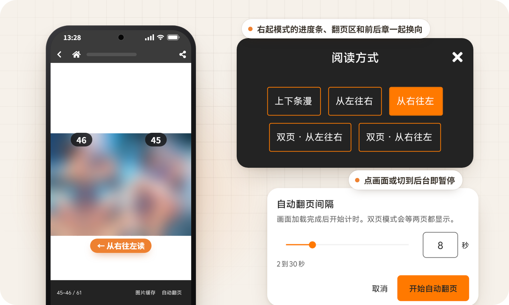
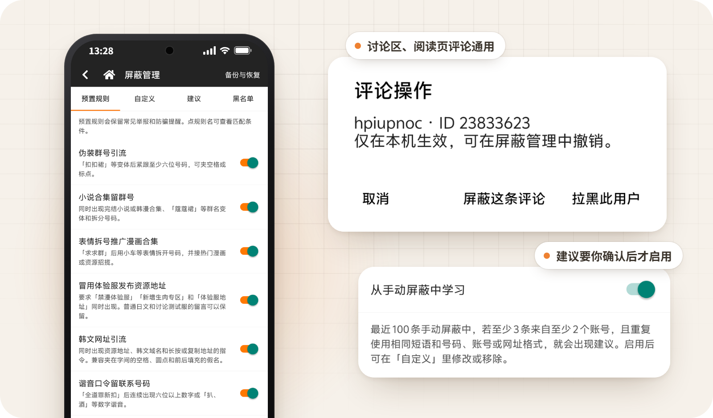

<picture>
  <source media="(prefers-color-scheme: dark)" srcset="docs/media/hero-dark.png">
  
</picture>

&nbsp;&nbsp;

0.1-rc21 · 内部版本 35 · Android ARM64 · 包名 <code>com.jiaohua_cleaner</code>，可与原版 JM2 共存

 

JM 洁净版是基于 JM2 1.8.2 的非官方安卓修改版。首页、分类、讨论区、个人中心四个入口和原版的推荐编排都保留着；游戏、小电影、博客和开屏推广去掉了，补上了右起双页、离线书架、逐章续读和评论过滤。

## 阅读

<picture>
  <source media="(prefers-color-scheme: dark)" srcset="docs/media/reading-dark.png">
  
</picture>

- **五种阅读方式**：上下条漫、从左往右、从右往左，以及左起、右起两种双页。右起模式下，进度条、点击翻页区和前后章按钮一起换向。
- **双页按方向排**：第 1、2 页为一组，末尾落单的一页单独显示。
- **自动翻页**：间隔 2～30 秒，图片显示后才开始计时，双页会等两张都出来。点画面、打开目录或切到后台就暂停，读到本章末尾自动停。
- **图片缓存可调**：离开画面后保留的已读图片 0～100 张，向前预加载 0～20 张。
- **逐章续读**：每章读到第几页记在本机。读过的书，详情页有“继续阅读”和“从头开始”两个入口。

## 评论区

<picture>
  <source media="(prefers-color-scheme: dark)" srcset="docs/media/filter-dark.png">
  
</picture>

- **随手处理**：评论菜单里可以屏蔽单条，或按账号拉黑。只在本机生效，随时能在“屏蔽管理”里撤销。
- **预置规则**：默认开启六条，对付伪装群号、小说合集留号、表情拆号、冒用体验服、韩文网址引流和谐音留号；资源招揽、博彩开户两条按需打开。每条都可以编辑、关闭或删除。
- **自定义规则**：支持关键词和 RE2 正则。一条简体规则能同时匹配繁体和繁简混写，正则命中时自动拉黑发言账号。
- **学习建议**：最近 100 条手动屏蔽里，同一种格式涉及至少 3 条评论、2 个账号，才会提示新规则，你确认后才启用。

## 线路、离线与记录

<picture>
  <source media="(prefers-color-scheme: dark)" srcset="docs/media/more-dark.png">
  
</picture>

- **选线**：每条线路显示首页和章节的实际加载耗时，推荐线路参考本机最近一周的表现。可以单线测速或全部重测，测速不加载封面。读取失败时 18 秒内最多换三条线路，发评论这类写操作只提交一次。
- **离线书架**：下载的原始 ZIP 存在手机的 `Download/JM洁净版`，阅读时按页解压，退出章节即释放。断网时可以从选线页直接进本地下载。
- **观看记录**：个人中心可以切换本机记录和账号记录，本机记录标出读到第几页。
- **备份与恢复**：屏蔽规则、黑名单和观看记录导出成一个压缩文件。导入时合并去重，同一本书保留本机进度。

## 精简与隐私

去掉了游戏、小电影、博客的页面和入口，开屏、首页推荐流、讨论区和阅读页的部分推广位，广告初始化组件，以及页面切换和图源切换的统计调用。应用内安装 APK 的权限也删了。

菜单、书名、章节和评论统一显示为简体中文；昵称、网址和你自己输入的内容保持原文。

## 安装

1. 在 ARM64 安卓手机上下载 APK。浏览器拦截 APK 的话，可以从[版本页](https://github.com/Sherkirito/JM-Clean/releases/tag/v0.1-rc21)下载 ZIP，解压后安装。
2. 已经装了同签名洁净版的，直接覆盖更新。
3. 首次打开选一条线路进入首页。有备份的话，在“屏蔽管理 → 备份与恢复”里导入。

<b>其他改动</b>

 

- **编号搜索**：返回搜索页后可以再搜同一个编号。详情缺失时给出提示，可以重试或返回；源站少了可选字段，已有的详情照常显示。
- **章节与评论**：阅读页的章节列表和评论共用底部面板，打开时才加载，同一章再次打开讨论会复用已加载的评论。
- **本机记录体积**：书目每 128 本存为一组，省去逐条重复的字段名。1,024 条模拟记录的书目索引从 83,717 字节降到 41,757 字节。旧记录在下次写入时自动迁移。

<b>和 JM3 比较</b>

 

JM3 2.1.13 的更新记录里有进度导入导出和小电影分类，2.0.27 起可以删除评论（[2.1.13](https://github.com/hect0x7/JMComic-APK/releases/tag/2.1.13) · [2.0.27](https://github.com/hect0x7/JMComic-APK/releases/tag/2.0.27)）。洁净版的不同在于逐章续读记在本机，隐藏评论、关键词、正则和账号黑名单集中在一处管理。

体积上，JM3 2.1.13 的归档安装包约 4.74 MiB，比洁净版小；对照用的 JM2 1.8.2 安装包为 36.67 MiB，含四种处理器架构，洁净版只打包 ARM64。三者在同一台设备上的启动速度、内存占用和崩溃率还没有对照数据。

## 源码与构建

仓库公开了 rc21 相对 JM2 新增和修改的应用模块、原生组件、构建补丁和回归测试。

| 目录 | 内容 |
| --- | --- |
| [`src/`](src/) | 阅读器布局与缓存、线路重试、本机记录、评论过滤、界面和导航 |
| [`native/`](native/) | 本地书架、ZIP 按页读取、文件选择与备份 |
| [`build.py`](build.py) · [`native_build.py`](native_build.py) | 把改动合入 JM2 派生底包，调整清单、组件和资源，编译新增原生代码 |
| [`tests/`](tests/) · [`BUILD.md`](BUILD.md) | 本地验证，以及生成未签名 APK 的步骤 |
| [`tools/early/`](tools/early/) | 早期版本的模块检查与修改脚本，用来追溯改动 |

## 许可

本项目自己编写的部分采用 [MIT 许可证](LICENSE)。修改过的上游模块保留原有权利；构建底包和 APK 中沿用的 JM2 程序、素材和第三方组件分别沿用各自的权利与许可。源站提供的漫画和评论不在本项目的授权范围内。

本项目与 JM 官方无隶属关系。
