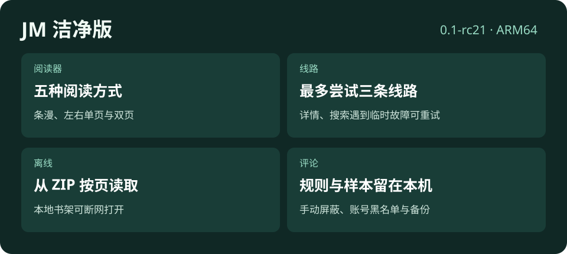

# JM 洁净版



基于 JM2 1.8.2 修改的非官方 Android 漫画阅读器。保留原版首页的推荐编排，增加右起双页、本地 ZIP 阅读、逐章续读和评论过滤。

**[下载 Android 安装包](https://github.com/Sherkirito/JM-Clean/releases/download/v0.1-rc21/JM-Clean-0.1-rc21-arm64.apk)** · [版本说明与 ZIP](https://github.com/Sherkirito/JM-Clean/releases/tag/v0.1-rc21)

| 当前版本 | Android 内部版本号 | 处理器 | 包名 |
| --- | --- | --- | --- |
| 0.1-rc21 | 35 | ARM64 | `com.jiaohua_cleaner` |

## 相比原版 JM2，有哪些变化？

| 使用场景 | JM洁净版 0.1 的改动 |
| --- | --- |
| 首页和分类 | 保留 JM2 的推荐栏目、每周更新、横向书架和最新上传三列卡片。分类有自己的底部入口，切换分类无需离开首页去找菜单。 |
| 模块精简 | 移除游戏、小电影、博客的页面、导航入口及对应的业务依赖，去掉开屏、首页推荐流、讨论区和阅读页中的部分推广位。书架分批加载卡片。 |
| 阅读方向 | 在条漫和从左往右单页的基础上，加入右起单页、左起双页和右起双页。右起模式的进度条、点击翻页区域、前后章按钮一起换向。双页按阅读方向排列，末尾落单的一页独立显示。 |
| 编号搜索 | 只处理当前查询的跳转。返回搜索页后可以再次搜索同一编号。详情缺失时显示提示，可重试或返回；源站缺少可选字段时仍可阅读已有的详情。 |
| 章节和讨论 | 阅读页的章节列表和评论共用底部面板。打开时才加载相应内容，再次打开同一章的讨论可复用已经加载的评论。 |
| 线路选择 | 选线页显示线路状态，支持单线测速和全部重测。推荐参考本机最近一周首页请求、章节数据和阅读页就绪的实际表现。手动测速只请求推荐数据，不加载封面。只读请求失败时可尝试备用线路，发评论等写入操作只提交一次。 |
| 观看记录 | 在本机保存各章页码和阅读方式。个人中心可切换本机记录和账号记录，沿用三列封面卡片。本机记录按当前图源加载封面，点开可接着读。 |
| 本机记录体积 | 旧记录在下次写入时自动迁移。书目每 128 本存为一组，省去逐条重复的字段名。用 1,024 条模拟记录测得，书目索引从 83,717 字节降到 41,757 字节。此数值只计书目索引。 |
| 评论广告 | 在讨论区和阅读页可隐藏单条评论、按账号拉黑，或用关键词和正则屏蔽评论及回复。一条简体规则可匹配繁体和繁简混写。正则命中时按作者编号自动拉黑，同一账号只记一次。黑名单可在本机撤销并随备份恢复。 |
| 新广告格式 | 六条默认规则覆盖拆分群号、表情分隔、谐音留号、冒用体验服和用韩文域名引导复制访问等广告。预置正则可以编辑、删除或关闭，也可以新增。启用学习后，最近 100 条手动屏蔽记录中，同一格式至少涉及 3 条评论、2 个账号才会给出建议，由你确认启用。 |
| 备份与恢复 | 屏蔽规则、手动屏蔽样本、黑名单和本机观看记录可导出为一个压缩文件。导入按项去重，同一本书保留本机的最近章节和页码，并补入备份中独有的已读章节。 |
| 简体中文 | 菜单、提示、书名、章节标题、评论及阅读模板的文字统一显示为简体。昵称、输入内容、网址和自定义表达式保留原文，漫画图片沿用源站提供的版本。 |

### 离线下载与图片缓存

下载的原始 ZIP 位于手机的 `Download/JM洁净版`。断网时可从选线页进入「本地下载」，打开书目后继续阅读。阅读器按需解压当前页，退出章节后释放临时图片。作品评论仍需联网。

在线章节遵循来源的 HTTP 缓存策略。「图片缓存」可分别设置离开当前画面后保留的已读图片（0～100 张，默认 6 张）和向前预加载的图片（0～20 张，默认 2 张）。「自动翻页」支持 2～30 秒间隔，双页模式会等两张图都显示后再计时。

## rc21 修复了什么？

- **加载时切走再回来。** 阅读器会记住当前章节的就绪消息，回到前台后解除遮罩。非条漫模式遇到不兼容的模板时，可以选择「改用条漫重开」。
- **详情或搜索打不开。** 只读请求遇到临时故障时，在 18 秒总预算内最多尝试三条线路。连续失败可触发主线路切换，评论提交等写入操作仍只发一次。
- **备份被一条坏记录卡住。** 导出时跳过损坏的页码和单本已读记录；恢复时可用备份补回。合并会去重并保留有效的本机进度，新导入的评论样本可以参与学习建议。
- **广告与反诈提醒混在一起。** 收紧了过宽的豁免条件。损坏的预置正则会回退到默认规则。自动黑名单最多保留 2,000 个账号，解除记录与单条屏蔽记录各保留 500 项，最近 100 条可附学习样本。
- **安装与隐私。** 修复重复的文件提供器声明，移除应用内安装 APK 权限、广告初始化组件，以及页面切换和阅读图源切换的统计调用。

## 安装与升级

1. 在 ARM64 Android 手机上下载 APK。选择 ZIP 的用户先解压，再打开其中的 APK。
2. 已安装同签名洁净版的用户可直接覆盖更新。系统设置里显示的版本名为 **0.1**，本次内部版本号为 **35**。
3. 首次打开后选择线路进入首页。已有备份可在「屏蔽管理 → 备份与恢复」中合并导入。

<details><summary>APK 的 SHA-256 校验值</summary>

```text
47d0f1a5f15ec745f8c45596750ff856f08e5f2127f6f4c4e545aab4b531be63
```

</details>

## 验证范围

19 个自动化回归脚本通过。Android 17 真机验证了从内部版 34 覆盖到 35、冷启动、选线、搜索、离线章节、在线回翻和前后台恢复。在线测试从第 41 页回翻到第 11 页，再回到原来的第 33 页。使用已有数据导出备份，已到达系统保存界面。没有 Android 13、14 真机测试结果。

本项目与 JM 官方无隶属关系。APK 中沿用的程序、素材和第三方组件保留各自权利。
